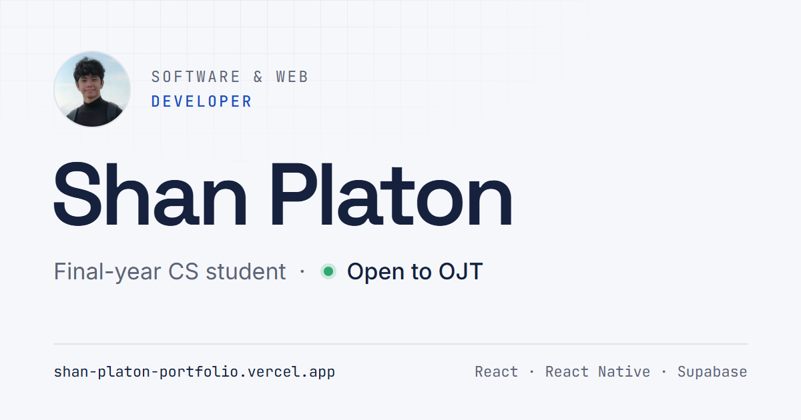

# Shan Platon — Developer Portfolio



My portfolio as a final-year Computer Science student at De La Salle Lipa:
a home page with About, Skills, Projects and Contact, and a page for each
project with its overview, my part in it, features and screenshots.

**Live:** https://shan-platon-portfolio.vercel.app

## Features

- A page per project (`/projects/:id`) with a screenshot carousel and a
  full-screen screenshot viewer (swipe, arrow keys, deep links like `?shot=3`)
- Light and dark mode: follows the system setting, with a day/night switch in
  the header that is remembered per browser; switching draws the new theme in
  like a curtain from both sides
- The address follows the section being read, so a reload or a copied link
  lands there, and a reload keeps your exact spot
- On phones, the section links get a second row in the header
- Built for keyboard and screen-reader use: skip link, visible focus, 44px
  tap targets, reduced-motion support, WCAG AA contrast in both themes
- Its own link-preview card per project, real 404s, a sitemap, and visit
  counts with Vercel Web Analytics (no cookies)

## Tech stack

- [React 18](https://react.dev) and [React Router](https://reactrouter.com)
- [Vite](https://vitejs.dev) for the dev server and the build
- [Tailwind CSS](https://tailwindcss.com), with the colours as CSS variables
  so one set of classes covers both themes
- Self-hosted variable fonts from [Fontsource](https://fontsource.org):
  Inter, Space Grotesk and JetBrains Mono
- Hosted on [Vercel](https://vercel.com)

## Project structure

```
├── index.html               # Entry HTML: meta and preview tags, dark-mode script
├── vite.config.js           # Builds sitemap.xml, the project pages and 404.html
├── vercel.json              # Routes, redirects, caching and security headers
├── tailwind.config.js       # Theme tokens (colours read from CSS variables)
├── scripts/
│   └── make-image-copies.js # npm run images: smaller screenshot copies
├── public/
│   ├── og.png               # The site's link-preview card
│   ├── og/<id>.png          # Each project's link-preview card
│   └── projects/<id>/       # Screenshots and their smaller copies
└── src/
    ├── main.jsx             # Entry: fonts, router, error fallback, analytics
    ├── App.jsx              # Routes
    ├── Home.jsx             # Hero, About, Skills, Statement, Projects, Contact
    ├── ProjectDetail.jsx    # /projects/:id
    ├── NotFound.jsx         # Page not found
    ├── index.css            # Theme colours (light and dark), shared classes
    ├── data/content.js      # All the text, projects and links
    ├── utils.js             # Small shared helpers
    └── components/          # Sections, headers, theme switch, viewer, etc.
```

## Getting started

Requires [Node.js](https://nodejs.org) 20.9+ (`npm run images` uses sharp;
the site itself builds on 18+).

```bash
npm install
npm run dev       # dev server, usually http://localhost:5173
npm run build     # static site in dist/
npm run preview   # serves dist/ locally
```

## Routes and deployment

- `/` — the home page
- `/projects/:id` — a page per project, from the `projects` list in
  `src/data/content.js` (matched by `id`)
- `/projects` — redirects to the Projects section of the home page
- anything else — the Page not found page, with a real 404 status

Vercel builds and deploys every push to `main`. `npm run build` writes
`dist/projects/<id>/index.html` for each project, with that project's title,
description, address and preview card in the HTML, since link previews never
run the JavaScript. `vercel.json` serves those files, sends `404.html` for
any other address, and sets the caching and security headers.

## Editing content

The text, skills, projects and links live in `src/data/content.js`; the
components handle layout and styling. The comments on the first project
explain each field.

## Link previews

- `public/og.png` is the home page's 1200x630 card. The name, role and
  availability are part of the image, so replace it if any of them change.
- `public/og/<id>.png` is each project's card, with its name, a short line and
  its main screenshot. Redo a card when that project's name or main
  screenshot changes; a project without one uses `og.png`.
- `sitemap.xml` is generated from the project list on every build, and
  `public/robots.txt` points to it.

## Adding project screenshots

1. Add image files to `public/projects/<id>/` (WebP; about 1920px wide, phone
   shots about 780px).
2. Run `npm run images`. It writes smaller copies next to each screenshot
   (`<name>-640w.webp`, `-1024w` and `-1280w`; `-360w` and `-480w` for
   portrait phone shots), so phones and small windows download a smaller
   file. Run it again whenever a screenshot changes, and commit the copies
   with the screenshots. Don't end a screenshot's own name in `-<number>w`,
   as that marks a copy.
3. In `src/data/content.js`, on the project's entry, set `image` to the main
   shot's path (home card and Overview shot), with `imageAlt` and
   `imageCaption` beside it. `screenshots` (carousel) and the optional
   `phoneScreenshots` are lists of `{ src, caption, alt }`. Set `shotSize` /
   `phoneShotSize` to the files' pixel size; the pages work out which copies
   exist from these sizes, so keep them exact.
4. If left empty, the card and the project page show a
   "Screenshots coming soon" placeholder.

## Adding a profile photo

1. Add a 4:5 portrait to `public/` (about 600x750 or larger, face near the
   centre), e.g. `public/profile.jpg`.
2. In `src/data/content.js`, set `profile.image` to `"/profile.jpg"`. It fills
   the photo frame beside the hero text on desktop and a small circle on
   phones. Left as `null`, both show initials.

## Adding a downloadable resume

1. Add the file to `public/`, e.g. `public/resume.pdf`.
2. In `src/data/content.js`, set `profile.resume` to `"/resume.pdf"`. The hero
   then shows a Resume button next to GitHub.

## License

MIT, see [LICENSE](LICENSE). You may reuse and change the code, as long as
the copyright notice with my name stays in your copy.
